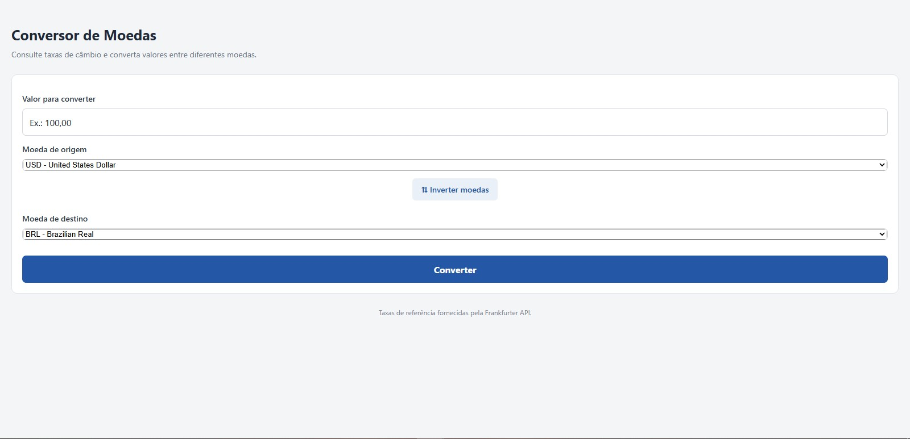
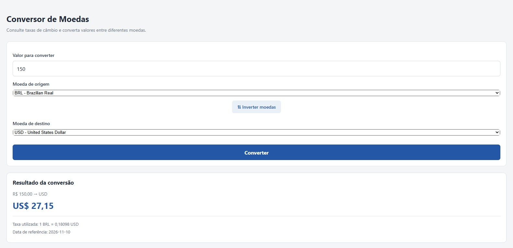
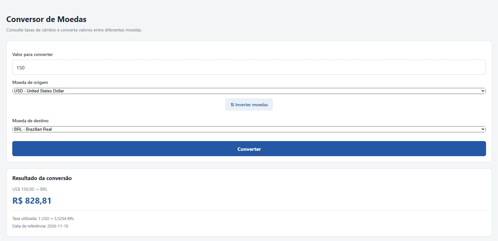
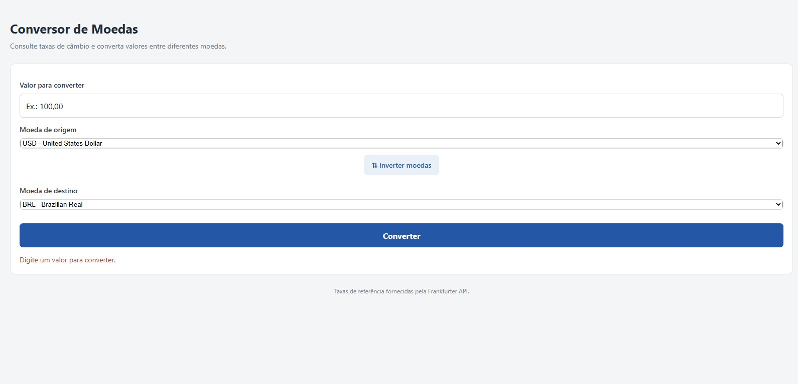

<div align="center">
  
</div>

# Conversor de Moedas

Aplicação mobile desenvolvida com **React Native e Expo**, que permite converter valores entre diferentes moedas utilizando taxas de câmbio fornecidas pela Frankfurter API.

O projeto foi desenvolvido como atividade prática da disciplina de Programação para Dispositivos Móveis, com foco na construção de interfaces, gerenciamento de estados, integração com API externa e organização do código.

---

## Sobre o projeto

O Conversor de Moedas permite que o usuário informe um valor, selecione uma moeda de origem e uma moeda de destino e consulte o resultado da conversão com base nas taxas de câmbio disponibilizadas pela API.

A aplicação também permite inverter as moedas selecionadas, facilitando consultas em diferentes direções.

> **Curso:** Desenvolvimento de Software Multiplataforma  
> **Instituição:** FATEC Itaquera  
> **Disciplina:** Programação para Dispositivos Móveis  
> **Projeto:** Conversor de Moedas

---

## Funcionalidades

- Consulta de moedas disponíveis pela API;
- Seleção de moeda de origem e destino;
- Conversão de valores entre diferentes moedas;
- Inversão das moedas selecionadas;
- Exibição do valor convertido;
- Exibição da taxa de câmbio utilizada;
- Exibição da data de referência da cotação;
- Validação de campos obrigatórios;
- Apresentação de mensagens em caso de erro na consulta.

---

## Tecnologias utilizadas

- **JavaScript:** linguagem utilizada no desenvolvimento da aplicação;
- **React Native:** framework para construção da interface;
- **Expo:** ambiente e ferramentas para desenvolvimento mobile;
- **React Native Web:** suporte à execução da aplicação no navegador;
- **React Native Picker:** componente para seleção de moedas;
- **Frankfurter API:** serviço externo utilizado para consultar taxas de câmbio.

---

## API utilizada

O projeto utiliza a **Frankfurter API**, serviço que disponibiliza informações de taxas de câmbio entre diferentes moedas.

Documentação: https://frankfurter.dev/

As cotações são consultadas externamente, permitindo que os resultados sejam calculados com base nas taxas disponibilizadas pelo serviço.

---

## Capturas de tela

A seguir estão algumas capturas da aplicação em funcionamento, demonstrando suas principais funcionalidades e diferentes situações de uso.

### 1. Tela inicial



Apresenta a interface principal da aplicação, com o campo para informar o valor, os seletores de moeda de origem e destino e o botão para realizar a conversão.

### 2. Conversão de Real para Dólar



Demonstra uma conversão de 150 reais brasileiros (BRL) para dólares americanos (USD), exibindo o valor convertido, a taxa de câmbio utilizada e a data de referência.

### 3. Conversão de Dólar para Real



Demonstra a utilização da funcionalidade de inversão de moedas. Após trocar a origem e o destino, a aplicação realiza uma nova conversão de dólares americanos (USD) para reais brasileiros (BRL).

### 4. Validação de campos



Apresenta o comportamento da aplicação quando o usuário tenta realizar uma conversão sem informar um valor, exibindo uma mensagem orientando o preenchimento correto.

---

## Como executar o projeto

### Pré-requisitos

- Node.js instalado;
- npm instalado;
- Git;
- Expo CLI, executado por meio do NPX.

### Instalação

Clone o repositório:

```bash
git clone https://github.com/uBenetti/conversor-moedas.git
```

Entre na pasta do projeto:

```bash
cd conversor-moedas
```

Instale as dependências:

```bash
npm install
```

### Execução

Para iniciar a aplicação no navegador:

```bash
npx expo start --web
```

Também é possível iniciar o servidor Expo com:

```bash
npm start
```

---

## Organização do projeto

O código está organizado separando a interface, a lógica de conversão e o acesso aos dados, facilitando a manutenção e a compreensão da aplicação.

As capturas de tela utilizadas nesta documentação estão armazenadas em `assets/screenshots/`.

---

## Objetivo

Este projeto tem como objetivo aplicar conhecimentos de desenvolvimento de aplicações mobile, trabalhando com componentes, estados, eventos, consumo de APIs e apresentação de dados em uma interface interativa.

Além disso, busca desenvolver boas práticas de organização e estruturação de código durante a construção de uma aplicação funcional.

---

## Autor

<div align="center">

  **Pedro Benetti**

  Estudante de **Desenvolvimento de Software Multiplataforma — FATEC Itaquera**.

  [](https://github.com/uBenetti)

  [](https://instagram.com/o.pedrobenetti)

  [](mailto:pedrobenetti587@gmail.com)

  [](https://www.linkedin.com/in/o-pedrobenetti/)

---

<p align="center">
  Desenvolvido durante a disciplina de <strong>Programação para Dispositivos Móveis</strong> 📱
</p>


</div>